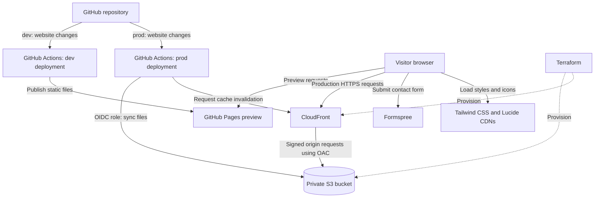

# Reflexology Website

A responsive, Greek-language website presenting Theodoros Koutris's reflexology
practice in Thessaloniki. Visitors can learn about the practitioner and services,
read testimonials, find contact details, call to arrange an appointment, and send
an enquiry through a contact form.

## What the project includes

- A static HTML website with responsive navigation, images and client-side JavaScript.
- Tailwind CSS and Lucide icons loaded from external CDNs.
- A contact form that submits directly to Formspree.
- GitHub Actions deployment workflows for GitHub Pages and AWS.
- Terraform definitions for S3, CloudFront and the deployment IAM role.

The published entry point is `bucket-contents/index.html`. The deployment workflows
upload the contents of that directory directly; they do not build the included
`page.tsx` file. There is no application server or database in this repository.

## Architecture

CloudFront serves the production site from an S3 origin protected by Origin Access
Control and a distribution-scoped bucket policy. Public S3 access is blocked.
GitHub Pages provides a separate preview path without requiring AWS.

The diagram describes the repository configuration, not a verification of live
deployments. Custom-domain and ACM settings are optional and currently commented
out in the CloudFront configuration.

## Repository overview

| Location | Purpose |
| --- | --- |
| [bucket-contents/](bucket-contents/) | Static website and supporting assets |
| [terraform/](terraform/) | AWS infrastructure definitions |
| [.github/workflows/](.github/workflows/) | Deployment, validation, security and cost-check workflows |
| [.spacelift/config.yml](.spacelift/config.yml) | Spacelift configuration |
| [docs/SETUP.md](docs/SETUP.md) | Local preview, setup, deployment and troubleshooting instructions |
