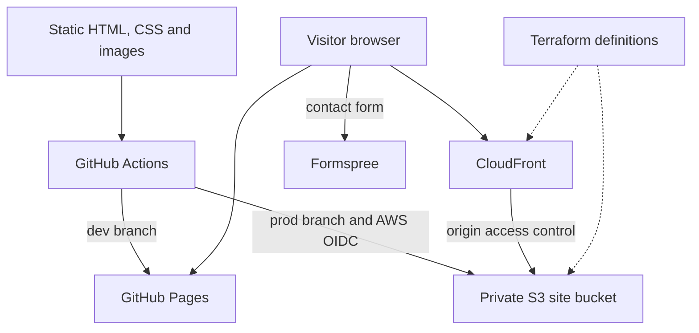

# Reflexology Website

A Greek-language static website for Theodoros Koutris's reflexology practice in Thessaloniki, presenting services, testimonials and contact information.

**Status:** Includes site files, Terraform definitions and deployment workflows. The configured paths are GitHub Pages for dev and S3/CloudFront for prod; live deployment is not verified by this README.

## Architecture

## Start here

Preview with `python3 -m http.server 8000 --directory bucket-contents`. Review [bucket-contents/index.html](bucket-contents/index.html), [terraform/](terraform/) and [docs/SETUP.md](docs/SETUP.md) before configuring deployment. The contact form submits to Formspree; this repository contains no appointment-booking backend.

[Previous README and detailed reference](https://github.com/mtzanida/reflexology/blob/fb756c2a719c7ab5caef7fcd941998d2baf8fe6f/README.md) are retained in Git history. They may describe older assumptions or unmerged plans; the scope above reflects this branch.
